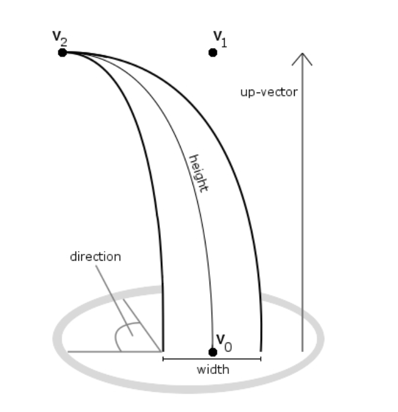
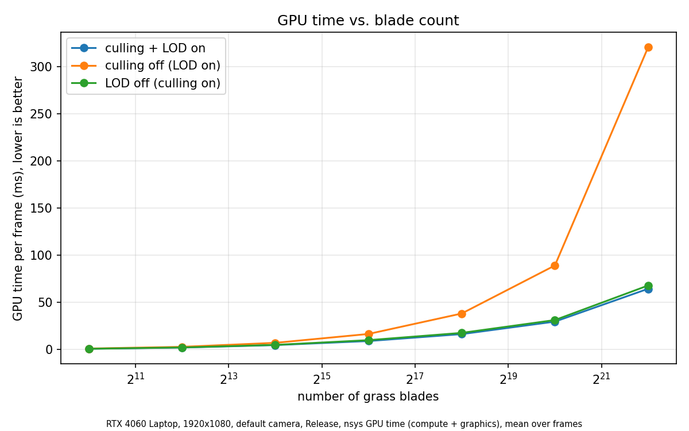
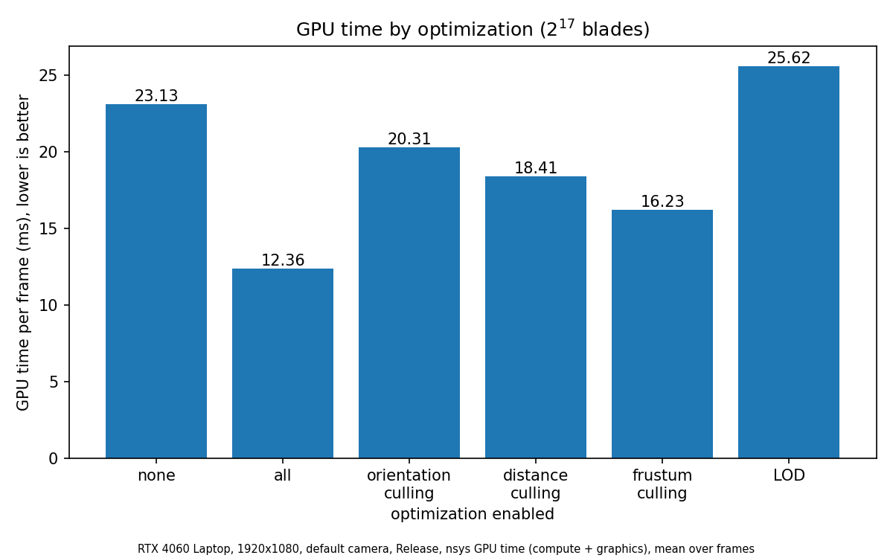

# vulkan grass rendering

**University of Pennsylvania, CIS 565: GPU Programming and Architecture, Project 5**

- Zachary Leong
    - [LinkedIn](https://linkedin.com/in/zleong), [personal website](https://zacharyleong.com)
- Tested on: Windows 11, Ultra 9 185H @ 2.30GHz 32GB, RTX 4060 Laptop (personal)

## overview

Real-time grass rendering in Vulkan based on [Responsive Real-Time Grass Rendering for General 3D Scenes](https://www.cg.tuwien.ac.at/research/publications/2017/JAHRMANN-2017-RRTG/JAHRMANN-2017-RRTG-draft.pdf). Grass blades are simulated and culled using compute shaders, and are tessellated at varying LODs for rendering using tessellation control and evaluation shaders.

## features

- Bezier grass blades
- Physics: gravity, recovery, wind, state validation, collisions
- Culling: orientation, frustum, distance
- LODs by distance
- Shaded scene with distance fog

## pipeline

### grass blades

*Responsive Real-Time Grass Rendering for General 3D Scenes*

Each blade is represented by 3 Beizer curve control points and other attributes packed into 5 vec4s:
1. **v0**
    1. xyz: position of grass blade
    1. w: orientation/direction
2. **v1**
    1. xyz: middle curve guide
    1. w: width
3. **v1**
    1. xyz: primary curve guide that we simulate forces on
    1. w: height
4. **up**
    1. xyz: up vector corresponding to the normal of the geometry
    1. w: stiffness
5. **force**
    1. xyz: padding (for struct alignment)
    1. w: collision strength (decays over time)

### simulation and rendering pipeline

on startup, grass blades are randomly placed on the CPU and allocated to a GPU buffer.

once per frame:
1. **compute pipeline**
    1. Dispatch one thread per grass blade, applying physics forces, state validation, and culling (using atomics)
2. **graphics pipeline**
    1. Input Aseembler (groups each grass blade into a patch)
    2. Vertex Stage (applies model matrices to orient the grass blades along the surface's normal)
    3. Tessellation Control (sets subdivision level based on width and height of the blade, and varies level of detail (LOD) based on blade distance to camera)
    4. Tessellator (subdivides a quad based on the specified levels of subdivision)
    5. Tessellation Evaluation (interpolates generated positions along the beizer curve and applies camera matrices)
    6. Rasterization (fixed function stage that flattens the scene and uses a scanline algorithm to produce fragments at each pixel for each overlapping primitive)
    7. Fragment Stage (runs once per fragment to color the final pixel using the uv attribute)
    8. Color Blending (fixed function stage that blends the output fragment colors with the render target)

## physics

### collisions

## culling

### frustum culling

_threshold exaggerated for demonstration_

## performance analysis

I used Nsight Systems command line tool to measure total GPU frame time (compute + graphics).

Culling makes the largest difference as expected. 

Overall, compared to no optimizations enabled, our gpu frame time is cut by about half with all optimizations enabled. The culling methods all reduce frame time and frustum culling has the greatest impact as expected. The LODs optimization increasing frame time is unexpected, but could be explained by additional matrix and distance calculations to set the levels. This also indicates that rendering the geometry is not the primary bottleneck, and the bottleneck is likely in the compute shader.

Future optimizations: subgroup atomics (currently using device-wide atomics), task and mesh shaders, frame-in-flight resources.
